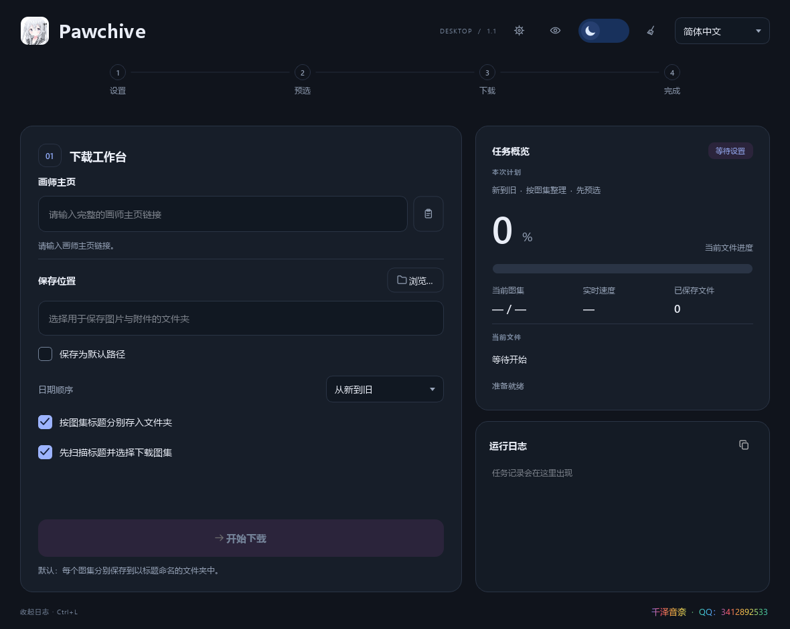

# Pawchive Downloader

<p align="center">
  
</p>

用于保存 Pawchive 画师主页中图片原图和帖子附件的开源工具，提供 **Windows 桌面版**和 **Android 版**。先看封面、再选图集，按日期与标题整理文件；Windows 版还支持后台运行、预约下载与断点恢复。



## 选择你的版本

| 平台 | 下载与使用 | 详细说明 |
| --- | --- | --- |
| Windows 64 位 | [下载 Windows v1.1.0 EXE / ZIP](https://github.com/316824/Pawchive-Downloader/releases/tag/windows-v1.1.0)，无需安装 Python | [Windows 使用与构建指南](windows/README.md) |
| Android ARM64 | 在 [Actions](https://github.com/316824/Pawchive-Downloader/actions/workflows/build-android.yml) 下载最近一次成功构建的 APK，下载 Artifact 需要登录 GitHub | [Android 使用与签名指南](docs/ANDROID.md) |

Windows 推荐下载 `PawchiveDownloader-Windows-x64.zip`，解压后双击 `PawchiveDownloader.exe`。ZIP 附带使用说明、MIT 许可证和第三方许可文件；发布页也提供对应的单独 EXE。**v1.1.0 官方 Windows 版本首次使用需要设备专属邀请码**，验证后保存在本机，后续启动无需反复填写。

当前本地分支还包含一组待发布的 Windows 增强：画师等级、徽章、画师图鉴、成就彩蛋、可解锁主题皮肤，以及仅供维护者使用的本机记录清理工具。GitHub 发布页仍以现有版本为准，下面的 v1.2.0 说明可在日后上传时直接采用。

**Android 兼容性仍在验证**：已收到 Android 16 可以打开应用的反馈，Android 12 测试设备存在启动闪退，Android 13～15 尚未验证。目前最低兼容版本尚未确定，安装前请查看 [Android 兼容性说明](docs/ANDROID.md#设备要求与兼容性)。本次后台、日程、续传和邀请机制更新仅适用于 Windows。

## 主要功能

- 输入完整画师主页链接，自动读取分页中的图集。
- 预览封面、标题和直链附件类型，逐个选择需要下载的图集。
- 支持从新到旧、从旧到新排序，以及扫描的暂停、继续与提前结束。
- 保存图片原图和页面直接提供的附件，如 ZIP、MP4、PSD 等。
- 默认按图集标题创建文件夹，也可平铺保存并按发布日期编号。
- 显示文件下载进度、图集序号和日志，处理临时连接失败与文件重名。

两个平台的界面与实现不同，具体选项以各自指南为准。

### Windows 桌面版（v1.1.0 基线 + v1.2.0 待发布增强）

| 功能 | 使用方式与效果 |
| --- | --- |
| 新工作台 | 分区布局、实时任务状态、文件与图集统计；保留明暗主题、四种语言、鼠标粒子、复选框动画和彩虹进度条 |
| 后台运行 | 点击窗口右上角 `×`，选择“留在后台”；从系统托盘重新打开或正常退出 |
| 下载日程 | 工具齿轮 → 下载日程，最多保留 10 个活动预约；时间到后下载对应画师全部图集，多个任务依次执行 |
| 进度恢复 | 下载中选择“保存并退出”，下次启动可继续、稍后处理或放弃进度；已保存的文件会保留 |
| 签到日历与奖励 | 工具齿轮 → 签到日历；记录今天、回看足迹，并查看画师等级、徽章、图鉴、成就彩蛋与已解锁主题 |
| 设备邀请码 | 复制首次启动显示的设备码，向维护者获取邀请码；在本机离线验证，无设备信息自动上传 |
| 画师成长展示 | 工作台顶部显示当前等级与最近获得的徽章；奖励只代表本机使用进度，不改变下载权限 |
| 日常辅助 | `Ctrl+Shift+V` 粘贴链接、`Ctrl+L` 显示／收起日志、日志复制、缓存清理、下载后打开文件夹 |

预约使用当前 Windows 登录用户的计划任务，通常无需管理员权限或 Windows 密码。**电脑必须开机且该用户已登录，锁屏时可以执行；关机、睡眠、休眠或未登录期间错过的预约不会补跑，也不会唤醒电脑。** 预约不是周期任务，每次预约只执行一次；正在运行的任务结束后才会开始下一项。

## Windows 快速开始

1. 从 [Windows v1.1.0 发布页](https://github.com/316824/Pawchive-Downloader/releases/tag/windows-v1.1.0) 下载并解压 ZIP。
2. 双击 `PawchiveDownloader.exe`。首次使用时复制设备码，联系维护者取得并填写该设备的邀请码。
3. 输入完整画师主页地址，例如 `https://pawchive.pw/fanbox/user/76050360`。
4. 选择保存文件夹，设置日期顺序和保存方式，点击“开始下载”。
5. 默认先扫描并打开封面选择窗口；确认所选图集后继续下载。
6. 下载结束后，点击状态旁的“打开文件夹”查看文件。

主页链接无效或尚未选择保存文件夹时，“开始下载”不可用。单篇帖子链接不适用于主页扫描入口。

需要无人值守下载时，打开工具齿轮中的“下载日程”，填写画师主页、保存位置、未来时间和保存规则。定时任务下载该画师的全部图集，不会停在封面预选窗口。等待续传的预约也计入 10 个活动名额；取消预约或完成任务后释放名额。

完整的后台操作、续传说明、本机数据位置、邀请锁定规则和日程限制见 [Windows 指南](windows/README.md)。

### 签到奖励机制（v1.2.0 待发布方案）

签到只保存在本机，不上传，也不影响下载权限。每天按当前 Windows 本地日期只能记一次；没有补签或未来日期签到。错过一天只会重置“当前连续天数”，已经解锁的奖励和历史最高连续纪录不会被收回。

| 进度依据 | 解锁内容 | 具体规则 |
| --- | --- | --- |
| 累计签到 0 / 7 / 30 / 100 / 365 天 | 画师等级：初见画师、灵感学徒、连载画师、资深画师、传说画师 | 等级按累计签到天数提升；签到窗口会显示距离下一级还差几天 |
| 累计签到 1 天 | “第一束灵感”徽章、第一页·初见图鉴、欢迎回来成就 | 第一次成功签到即获得 |
| 最高连续 7 天 | “七日连星”徽章、七日手记图鉴、连星初成成就 | 以历史最高连续纪录计算，断签后仍保留 |
| 最高连续 30 天 | “月度不缺席”徽章、海蓝档案图鉴、月度连载成就 | 同时解锁“海蓝潮汐”和“霓虹赛博”两套主题皮肤 |
| 最高连续 100 天 | “百日长卷”徽章 | 作为长期连续签到彩蛋展示 |
| 累计签到 100 天 | “百次回访”徽章 | 与连续 100 天分开计算，适合断续使用者 |
| 成功下载 1 次 | 第一份档案成就 | 只有下载任务成功完成后才计入 |
| 成功保存 100 / 500 个文件 | 百图收藏家、大档案室图鉴 | 计数保存在本机，重复启动不会丢失 |

在签到日历底部可以切换已经解锁的主题；当前选中的皮肤会保存到本机，明暗模式仍可独立切换。徽章、图鉴和成就采用三个分页展示，锁定项目会显示解锁条件，方便用户把它们当作 Steam 式的小彩蛋逐步收集。

## 本机数据与邀请机制

Windows 的语言、日程、签到和激活记录保存在 `%LOCALAPPDATA%\PawchiveDownloader`，默认路径使用当前用户的 Windows 设置存储。封面缓存会在正常退出时自动清理；为下次恢复下载保留的记录与 `.part` 分片单独管理，不会被扫帚按钮误清。选择放弃进度只会移除该任务的续传记录和临时分片，不删除已经保存的文件。

创建日程时，官方 EXE 会在上述目录的 `bin` 中保留一份稳定运行副本，当前约 **45 MB**。因此移动原来下载的 EXE 后，已登记的日程仍能找到程序；请保留这份副本和预约指定的保存位置。

邀请码绑定设备，客户端只包含验签公钥。错误邀请码累计 **10 次**会锁定尝试次数，重启不会重置；前 9 次失败后，第 10 次输入正确邀请码仍可通过。锁定后需向维护者申请该设备的解锁码。激活核对和签到均在本机完成，不自动上传设备信息或签到记录；联网用于访问 Pawchive 和下载内容。

邀请机制是官方发行版的使用入口，**不能保证阻止传播或绕过**。本项目原创代码使用 MIT 许可证，允许按许可证修改和再分发，包括修改客户端验证逻辑；邀请机制不会收回这些权利。签发私钥和维护者签发工具不随公开源码或发布包分发。

### 发布者本机记录清理工具

`windows/publisher_cleanup.ps1` 与 `windows/PawchivePublisherCleanup.cmd` 只面向维护者使用，不应放进公开发行包。工具会先校验当前 Windows 用户，只处理该用户创建的 `PawchiveDownloader-<当前用户哈希>-<日程 ID>` 计划任务，然后清理 `%LOCALAPPDATA%\PawchiveDownloader`（签到、等级、徽章、皮肤、激活、日程、断点、定时任务副本和错误日志）。它不会触碰已下载文件、用户下载目录、`.part` 分片或邀请码签发私钥。

建议发布前先预览，再执行完整清理：

```powershell
cd windows
.\PawchivePublisherCleanup.cmd -Preview
.\PawchivePublisherCleanup.cmd -RemoveRegistry
```

第二条命令会要求输入 `CLEAN` 后才执行；`-RemoveRegistry` 会额外删除 `HKCU\Software\PawchiveTools\PawchiveDownloader` 中的默认保存路径。若希望在已确认的自动化环境中运行，可使用 `publisher_cleanup.ps1 -RemoveRegistry -Force`。清理前必须退出主程序和托盘，且应确认没有仍需恢复的预约；下载目录中的已完成内容不会被删除。清理工具本身不包含私钥，也不会向网络发送数据。

## 从源码运行与构建

- **Windows**：进入 `windows` 目录，按 [Windows README](windows/README.md#从源码运行) 安装固定依赖，包括 PySide6、Requests、Beautiful Soup 和 Cryptography，再运行脚本或使用 PyInstaller 打包。源码默认使用相同的邀请验证流程。
- **Android**：保留仓库根目录的 `main.py` 作为移动版入口，使用 GitHub Actions 构建。签名密钥配置、APK 安装与构建环境见 [Android README](docs/ANDROID.md)。

```text
.
├── windows/
│   ├── download_pawchive_images.py   # Windows 桌面版入口与下载界面
│   ├── desktop_design.py            # 工作台布局与外观
│   ├── desktop_runtime.py           # 托盘、单实例与任务协调
│   ├── app_state.py                 # 本机设置、日程与签到
│   ├── windows_tasks.py             # 当前用户 Windows 计划任务
│   ├── download_journal.py          # 持久化下载记录
│   ├── resumable_worker.py          # 分片下载与恢复
│   ├── activation.py                # 设备绑定邀请验证
│   ├── activation_public.json       # 公开验签公钥
│   ├── publisher_cleanup.ps1        # 仅供发布者使用的本机记录清理工具
│   ├── PawchivePublisherCleanup.cmd # 双击启动清理工具的包装器
│   ├── 1.ico                        # 桌面版图标
│   ├── requirements.txt             # 固定的运行依赖
│   ├── requirements-build.txt       # 固定的构建依赖
│   ├── build_release.py             # 构建、依赖核查与离线自检
│   ├── PawchiveDownloader.spec      # Windows 打包配置
│   ├── tests/                       # 离线功能检查
│   └── README.md
├── docs/ANDROID.md                  # Android 使用和签名说明
├── main.py                          # Android 版入口
├── assets/app_icon.png              # Android 图标
├── scripts/                         # Android 构建配置辅助脚本
├── .github/workflows/               # Android 云端构建工作流
└── LICENSE
```

签名密钥、密码、个人设置、下载内容和本地备份不应提交到仓库。Android 工作流通过 GitHub Actions Secrets 读取发布密钥；Fork 仓库的维护者需要配置自己的密钥。

## 验证与问题反馈

Windows 构建包含系统 ICU 依赖核查和生成 EXE 的离线启动自检，继续保留 v1.0.1 对 `QtCore` 启动失败的修复。本次还检查了日程状态、恢复记录、邀请验证和界面行为，并在 Windows 11 当前用户下实际验证了临时计划任务的注册、按时自动启动与删除，未要求管理员权限。

这些检查不能替代所有 Windows 版本的实机兼容性测试，也不代表网站服务始终可用。页面结构、链接有效性或访问限制变化时，可能需要更新解析与下载逻辑。

欢迎通过 [Issues](https://github.com/316824/Pawchive-Downloader/issues) 反馈问题，或通过 Pull Request 改进代码、文档和翻译。请说明平台、程序版本、操作步骤和错误信息；可使用日志复制按钮提供去除个人信息后的日志，避免附带邀请码、密钥、私人路径或下载内容。

## 许可

本项目原创代码以 [MIT License](LICENSE) 发布。Python、PySide6 / Qt、Requests、Beautiful Soup、Cryptography、PyInstaller 等第三方组件遵循各自许可证；Windows ZIP 中附有第三方许可文本，MIT 许可不会替代它们。

本项目为非官方工具，与 Pawchive、Pixiv、Fanbox 及其他相关服务没有隶属或认可关系。请只保存你有权下载的内容，并遵守网站规则和相关版权要求。

## English

Pawchive Downloader is an unofficial open-source tool for Windows and Android. It scans creator pages, previews posts, and saves selected original images and direct-link attachments. Download [Windows v1.1.0](https://github.com/316824/Pawchive-Downloader/releases/tag/windows-v1.1.0), or read the [Android guide](docs/ANDROID.md).

The Windows release includes Python and its dependencies. It adds tray operation, up to 10 active one-time schedules, resumable downloads, a local check-in calendar with artist levels, badges, a cabinet, achievement easter eggs and unlockable colour skins, plus device-bound invitations. Scheduled downloads require the current Windows user to remain signed in on a powered-on PC; they work on the lock screen, do not wake the device, and do not catch up missed times after shutdown or sleep. First-run invitation verification is offline. After 10 failed attempts, a maintainer-issued device unlock code is required. Original project code remains MIT-licensed and may be modified; client-side activation cannot guarantee protection against bypassing.

Android compatibility is still being verified; no minimum compatible Android version has been established. Check the compatibility notes before installing. Download only content you are authorized to save.
